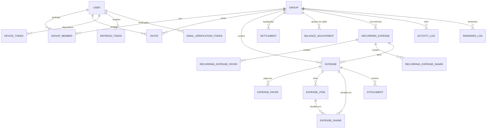

# Deliberate — Entidades do Banco de Dados

Modelo de dados do backend (PostgreSQL + EF Core), derivado de `CONTEXT.MD`. As classes ficam em `Deliberate.Domain`; a configuração do EF Core (mapeamentos, índices, migrations) fica na camada de infraestrutura.

## 1. Convenções gerais

| Tema                 | Convenção                                                                                                                                                             |
| -------------------- | --------------------------------------------------------------------------------------------------------------------------------------------------------------------- |
| **Chaves**           | `Guid` (`uuid`). Entidades criadas pelo app (despesa, itens, liquidação etc.) recebem o **ID gerado pelo cliente** para garantir idempotência no sync offline.        |
| **Dinheiro**         | `decimal` → `numeric(18,2)`, sempre em BRL. Nunca `float`/`double`.                                                                                                   |
| **Datas**            | `DateTimeOffset` → `timestamptz`, sempre UTC. `DateOnly` → `date` para datas de negócio (data da despesa).                                                            |
| **Enums**            | Persistidos como `text` (`HasConversion<string>()`), com `CHECK` opcional.                                                                                            |
| **Auditoria básica** | `CreatedAt` (chegada ao servidor), `UpdatedAt` (última escrita no servidor). O horário do cliente, quando relevante, vai em `ClientCreatedAt` e é apenas informativo. |
| **Soft delete**      | Despesas, anexos e demais registros financeiros usam `DeletedAt`/`DeletedByUserId`; filtro global do EF Core exclui os deletados das consultas normais.               |
| **Concorrência**     | Última escrita vence: **sem** `RowVersion`/token de concorrência.                                                                                                     |
| **Nomes**            | Tabelas e colunas em `snake_case` (ex.: `UseSnakeCaseNamingConvention`).                                                                                              |
| **FKs**              | `ON DELETE RESTRICT` por padrão; histórico financeiro nunca é apagado em cascata.                                                                                     |

> **Calculado, não persistido:** saldos por membro, painel do grupo e transferências sugeridas (simplificação de dívidas) são **derivados** de despesas, cotas e liquidações confirmadas. Não existe tabela para eles. Se houver gargalo de desempenho, avaliar cache/materialização depois.

---

## 2. Diagrama de relacionamentos

---

## 3. Identidade e acesso

### 3.1 `User` (`users`)

Conta no app. Pode ser baseada em ASP.NET Identity (mapeando para esta tabela) ou implementada manualmente.

| Campo                     | Tipo         | Regras                                                                                                |
| ------------------------- | ------------ | ----------------------------------------------------------------------------------------------------- |
| `Id`                      | uuid         | PK                                                                                                    |
| `Name`                    | text(120)    | obrigatório                                                                                           |
| `Email`                   | text(254)    | obrigatório, **único** (comparação case-insensitive; guardar `NormalizedEmail`)                       |
| `EmailConfirmedAt`        | timestamptz? | null = e-mail não verificado; sem verificação não acessa grupos                                       |
| `Phone`                   | text(20)?    | **único** quando preenchido (formato E.164); só serve como login alternativo, sem verificação por SMS |
| `PasswordHash`            | text         | hash seguro, nunca a senha                                                                            |
| `PixKey`                  | text(140)?   | chave PIX do usuário (para receber)                                                                   |
| `PixKeyType`              | text?        | `Cpf`, `Cnpj`, `Email`, `Phone`, `Random`                                                             |
| `CreatedAt` / `UpdatedAt` | timestamptz  |                                                                                                       |
| `DisabledAt`              | timestamptz? | desativação lógica da conta                                                                           |

Índices: únicos parciais em `normalized_email` e em `phone` (onde não nulo).

### 3.2 `RefreshToken` (`refresh_tokens`)

Sessões JWT renováveis.

| Campo                    | Tipo         | Regras               |
| ------------------------ | ------------ | -------------------- |
| `Id`                     | uuid         | PK                   |
| `UserId`                 | uuid         | FK → `users`         |
| `TokenHash`              | text         | hash do token, único |
| `DeviceName`             | text?        | informativo          |
| `CreatedAt`, `ExpiresAt` | timestamptz  |                      |
| `RevokedAt`              | timestamptz? |                      |

### 3.3 `EmailVerificationToken` (`email_verification_tokens`)

Confirmação de e-mail (e, futuramente, redefinição de senha via `Purpose`).

| Campo       | Tipo         | Regras                         |
| ----------- | ------------ | ------------------------------ |
| `Id`        | uuid         | PK                             |
| `UserId`    | uuid         | FK → `users`                   |
| `Purpose`   | text         | `VerifyEmail`, `ResetPassword` |
| `TokenHash` | text         | único                          |
| `ExpiresAt` | timestamptz  |                                |
| `UsedAt`    | timestamptz? |                                |

### 3.4 `DeviceToken` (`device_tokens`)

Tokens de push (FCM/APNs).

| Campo        | Tipo        | Regras                           |
| ------------ | ----------- | -------------------------------- |
| `Id`         | uuid        | PK                               |
| `UserId`     | uuid        | FK → `users`                     |
| `Token`      | text        | **único**                        |
| `Platform`   | text        | `Android`, `iOS`                 |
| `LastSeenAt` | timestamptz | tokens inativos podem ser limpos |

---

## 4. Grupos

### 4.1 `Group` (`groups`)

| Campo                     | Tipo         | Regras                                               |
| ------------------------- | ------------ | ---------------------------------------------------- |
| `Id`                      | uuid         | PK                                                   |
| `Name`                    | text(120)    | obrigatório                                          |
| `Description`             | text(500)?   |                                                      |
| `StartDate`, `EndDate`    | date?        | período opcional (ex.: viagem)                       |
| `CreatedByUserId`         | uuid         | FK → `users` (criador; não implica ser o único dono) |
| `CreatedAt` / `UpdatedAt` | timestamptz  |                                                      |
| `ArchivedAt`              | timestamptz? | grupo encerrado/arquivado (somente leitura)          |

### 4.2 `GroupMember` (`group_members`)

Vínculo usuário ↔ grupo. Registros **não são apagados** quando o membro sai, pois despesas antigas o referenciam.

| Campo            | Tipo         | Regras                                                       |
| ---------------- | ------------ | ------------------------------------------------------------ |
| `Id`             | uuid         | PK                                                           |
| `GroupId`        | uuid         | FK → `groups`                                                |
| `UserId`         | uuid         | FK → `users`                                                 |
| `Role`           | text         | `Owner`, `Member`                                            |
| `Status`         | text         | `Active`, `Left`, `Removed`                                  |
| `JoinedAt`       | timestamptz  |                                                              |
| `LeftAt`         | timestamptz? |                                                              |
| `RemindersMuted` | bool         | silencia lembretes de cobrança neste grupo (default `false`) |

Restrições:

- único `(GroupId, UserId)` (reentrada reativa o registro existente);
- sair (`Left`) só é permitido com **saldo zero**; remoção (`Removed`) com saldo diferente de zero dispara a distribuição em `balance_adjustments`;
- regra de domínio: todo grupo ativo tem **≥ 1** membro `Owner` com `Status = Active`; validar em serviço (e idealmente em transação ao rebaixar/sair).

### 4.3 `Invite` (`invites`)

Convite a **usuário já cadastrado**.

| Campo             | Tipo         | Regras                                                                    |
| ----------------- | ------------ | ------------------------------------------------------------------------- |
| `Id`              | uuid         | PK                                                                        |
| `GroupId`         | uuid         | FK → `groups`                                                             |
| `InvitedUserId`   | uuid         | FK → `users`                                                              |
| `InvitedByUserId` | uuid         | FK → `users` (precisa ser dono)                                           |
| `Code`            | text(12)     | código curto, **único**, para digitar no app                              |
| `LinkTokenHash`   | text         | hash do token do link, **único** (o token em claro só vai no e-mail/link) |
| `Status`          | text         | `Pending`, `Accepted`, `Declined`, `Expired`, `Revoked`                   |
| `CreatedAt`       | timestamptz  |                                                                           |
| `ExpiresAt`       | timestamptz  | `CreatedAt + 3 dias` por padrão                                           |
| `RespondedAt`     | timestamptz? |                                                                           |

Restrições:

- índice único parcial: apenas **um convite `Pending`** por `(GroupId, InvitedUserId)`;
- `Expired` pode ser derivado por `ExpiresAt < now` (job opcional apenas para consolidar o status);
- aceitar exige que o usuário logado seja o `InvitedUserId` (mesmo usando código/link).

---

## 5. Despesas

### 5.1 `Expense` (`expenses`)

| Campo                      | Tipo          | Regras                                                                          |
| -------------------------- | ------------- | ------------------------------------------------------------------------------- |
| `Id`                       | uuid          | PK, **gerado pelo cliente**                                                     |
| `GroupId`                  | uuid          | FK → `groups`                                                                   |
| `Description`              | text(200)     | obrigatório                                                                     |
| `Category`                 | text(50)?     | opcional                                                                        |
| `Amount`                   | numeric(18,2) | total, `> 0`                                                                    |
| `ExpenseDate`              | date          | data em que o gasto ocorreu                                                     |
| `SplitMethod`              | text          | `Equal`, `Percentage`, `Shares`, `Exact`, `ByItems` (itens com divisão própria) |
| `Origin`                   | text          | `User`, `Recurrence`                                                            |
| `RecurringExpenseId`       | uuid?         | FK → `recurring_expenses`                                                       |
| `RecurrenceOccurrenceDate` | date?         | ciclo que originou a despesa                                                    |
| `CreatedByUserId`          | uuid          | FK → `users`                                                                    |
| `CreatedAt`                | timestamptz   | chegada ao servidor                                                             |
| `ClientCreatedAt`          | timestamptz?  | informativo (offline)                                                           |
| `UpdatedAt`                | timestamptz   | base do **delta sync**                                                          |
| `UpdatedByUserId`          | uuid          | FK → `users`                                                                    |
| `DeletedAt`                | timestamptz?  | soft delete                                                                     |
| `DeletedByUserId`          | uuid?         | FK → `users`                                                                    |

Restrições e índices:

- único parcial `(RecurringExpenseId, RecurrenceOccurrenceDate)` onde não nulo → **idempotência** da geração recorrente;
- índices em `(GroupId, ExpenseDate)` e `(GroupId, UpdatedAt)` (delta sync, que inclui os soft-deleted);
- invariantes de domínio: `Σ payers.AmountPaid = Amount`; `Σ shares.Amount = Amount`; com itens, `Σ items.Amount = Amount`.

### 5.2 `ExpensePayer` (`expense_payers`)

Quem pagou (permite múltiplos pagadores).

| Campo        | Tipo          | Regras                       |
| ------------ | ------------- | ---------------------------- |
| `ExpenseId`  | uuid          | FK → `expenses`, parte da PK |
| `UserId`     | uuid          | FK → `users`, parte da PK    |
| `AmountPaid` | numeric(18,2) | `> 0`                        |

PK composta `(ExpenseId, UserId)`. O usuário deve ser membro do grupo à época do lançamento (validado no serviço).

### 5.3 `ExpenseItem` (`expense_items`)

Itens de uma nota fiscal, para o consumo assimétrico ("não bebi, não pago"). Só existe quando `SplitMethod = ByItems`.

| Campo         | Tipo          | Regras                                                                                                                                               |
| ------------- | ------------- | ---------------------------------------------------------------------------------------------------------------------------------------------------- |
| `Id`          | uuid          | PK, gerado pelo cliente                                                                                                                              |
| `ExpenseId`   | uuid          | FK → `expenses`                                                                                                                                      |
| `Kind`        | text          | `Item`, `ServiceFee`, `Tip`, `Cover`, `Discount`                                                                                                     |
| `Description` | text(200)     |                                                                                                                                                      |
| `Quantity`    | numeric(10,3) | default 1                                                                                                                                            |
| `Amount`      | numeric(18,2) | total da linha; **negativo** para `Discount`                                                                                                         |
| `SplitMethod` | text          | `Equal`, `Percentage`, `Shares`, `Exact` (para `ServiceFee`/`Tip`/`Cover`/`Discount` pode ser `Proportional`, rateando conforme o consumo dos itens) |
| `SortOrder`   | int           | ordem na nota                                                                                                                                        |

### 5.4 `ExpenseShare` (`expense_shares`)

Cota de cada participante. Guarda tanto o **dado de entrada** (peso, %, valor exato) quanto o **valor final calculado** pelo Domain.

| Campo           | Tipo           | Regras                                                                  |
| --------------- | -------------- | ----------------------------------------------------------------------- |
| `Id`            | uuid           | PK                                                                      |
| `ExpenseId`     | uuid           | FK → `expenses`                                                         |
| `ExpenseItemId` | uuid?          | FK → `expense_items`; null = cota da despesa inteira                    |
| `UserId`        | uuid           | FK → `users`                                                            |
| `Weight`        | numeric(10,3)? | usado em `Shares` (> 0)                                                 |
| `Percentage`    | numeric(5,2)?  | usado em `Percentage` (0–100)                                           |
| `ExactAmount`   | numeric(18,2)? | usado em `Exact`                                                        |
| `Amount`        | numeric(18,2)  | **valor final devido** (já com centavos residuais distribuídos), `>= 0` |

Restrições:

- único `(ExpenseId, ExpenseItemId, UserId)` — como `ExpenseItemId` pode ser nulo, usar `NULLS NOT DISTINCT` (PostgreSQL 15+) ou dois índices parciais;
- `Amount` é sempre calculado no backend; o valor enviado pelo cliente nunca é confiado sem revalidação;
- o **saldo do membro** = `Σ AmountPaid` (como pagador) − `Σ Amount` (como participante) ± liquidações confirmadas ± `Σ Amount` dos ajustes de saldo (`balance_adjustments`).

### 5.5 `Attachment` (`attachments`)

Metadados de comprovantes; o arquivo fica em armazenamento de objetos.

| Campo              | Tipo         | Regras                   |
| ------------------ | ------------ | ------------------------ |
| `Id`               | uuid         | PK, gerado pelo cliente  |
| `ExpenseId`        | uuid         | FK → `expenses`          |
| `UploadedByUserId` | uuid         | FK → `users`             |
| `StorageKey`       | text         | chave/caminho no storage |
| `FileName`         | text(255)    |                          |
| `ContentType`      | text(100)    |                          |
| `SizeBytes`        | bigint       |                          |
| `CreatedAt`        | timestamptz  |                          |
| `DeletedAt`        | timestamptz? | soft delete              |

> OCR/IA está adiado. Quando chegar, adicionar uma entidade de job (ex.: `ReceiptScan` com status e JSON da proposta) sem alterar `Attachment`.

---

## 6. Liquidações

### 6.1 `Settlement` (`settlements`)

Pagamento real (geralmente via PIX) entre dois membros. Só **liquidações confirmadas** entram no cálculo de saldo.

| Campo              | Tipo          | Regras                                                                     |
| ------------------ | ------------- | -------------------------------------------------------------------------- |
| `Id`               | uuid          | PK, gerado pelo cliente                                                    |
| `GroupId`          | uuid          | FK → `groups`                                                              |
| `FromUserId`       | uuid          | FK → `users` (quem pagou)                                                  |
| `ToUserId`         | uuid          | FK → `users` (quem recebeu); `<> FromUserId`                               |
| `Amount`           | numeric(18,2) | `> 0`                                                                      |
| `Status`           | text          | `Pending` (sinalizada pelo pagador), `Confirmed` (por um dono), `Rejected` |
| `Note`             | text(300)?    |                                                                            |
| `ReportedByUserId` | uuid          | FK → `users`                                                               |
| `ReportedAt`       | timestamptz   |                                                                            |
| `ClientCreatedAt`  | timestamptz?  | informativo                                                                |
| `ResolvedByUserId` | uuid?         | FK → `users` (dono que confirmou/rejeitou)                                 |
| `ResolvedAt`       | timestamptz?  |                                                                            |
| `UpdatedAt`        | timestamptz   | delta sync                                                                 |

Regras:

- somente donos do grupo confirmam ou rejeitam;
- donos também podem registrar uma liquidação já como `Confirmed`;
- confirmar e rejeitar geram eventos no feed.

### 6.2 `BalanceAdjustment` (`balance_adjustments`)

Lançamentos de ajuste de saldo gerados pelo sistema quando um membro é **removido com saldo diferente de zero** e sua posição é distribuída entre os demais membros ativos. Um evento de remoção gera um lote de linhas que **somam zero**.

| Campo               | Tipo          | Regras                                                                                             |
| ------------------- | ------------- | -------------------------------------------------------------------------------------------------- |
| `Id`                | uuid          | PK                                                                                                 |
| `GroupId`           | uuid          | FK → `groups`                                                                                      |
| `BatchId`           | uuid          | agrupa as linhas de uma mesma remoção                                                              |
| `UserId`            | uuid          | FK → `users` (quem tem o saldo alterado)                                                           |
| `Amount`            | numeric(18,2) | **com sinal**: positivo aumenta o saldo (a receber), negativo diminui (a pagar); `<> 0`            |
| `Reason`            | text          | `MemberRemoval`                                                                                    |
| `RemovedMemberId`   | uuid          | FK → `group_members` (membro removido que originou o ajuste)                                       |
| `CreatedByUserId`   | uuid          | FK → `users` (dono que removeu)                                                                    |
| `CreatedAt`         | timestamptz   |                                                                                                    |

Regras:

- Na remoção, o saldo do removido (`B`) é **zerado** com uma linha de valor `−B`, e o valor `B` é dividido **igualmente** entre os membros `Active` restantes (centavos residuais distribuídos de forma determinística, por ordem estável de `UserId`). A soma do lote é sempre `0`.
- Exemplo: o removido deve R$ 90 (`B = −90`) e restam 3 membros → linha `+90` para o removido e `−30` para cada um dos 3.
- Registros são imutáveis (apenas inserção) e nunca excluídos.
- Após a remoção, o removido fica com saldo `0` e não aparece mais nas transferências sugeridas.
- Só donos executam a remoção; a operação gera `MemberRemoved` e `DebtDistributed` no feed, na mesma transação.

---

## 7. Recorrência

### 7.1 `RecurringExpense` (`recurring_expenses`)

Modelo que gera despesas reais periodicamente.

| Campo                     | Tipo          | Regras                                                  |
| ------------------------- | ------------- | ------------------------------------------------------- |
| `Id`                      | uuid          | PK                                                      |
| `GroupId`                 | uuid          | FK → `groups`                                           |
| `Description`             | text(200)     |                                                         |
| `Category`                | text(50)?     |                                                         |
| `Amount`                  | numeric(18,2) | `> 0`                                                   |
| `SplitMethod`             | text          | `Equal`, `Percentage`, `Shares`, `Exact` (sem itens)    |
| `Frequency`               | text          | `Weekly`, `Monthly`                                     |
| `DayOfWeek`               | smallint?     | 0–6, obrigatório se `Weekly`                            |
| `DayOfMonth`              | smallint?     | 1–31, obrigatório se `Monthly` (mês curto → último dia) |
| `StartDate`               | date          |                                                         |
| `EndDate`                 | date?         |                                                         |
| `NextOccurrenceDate`      | date?         | próximo ciclo a gerar; consultado pelo job              |
| `Status`                  | text          | `Active`, `Paused`, `Ended`                             |
| `CreatedByUserId`         | uuid          | FK → `users`                                            |
| `CreatedAt` / `UpdatedAt` | timestamptz   |                                                         |

Índice em `(Status, NextOccurrenceDate)` para o job.

### 7.2 `RecurringExpensePayer` (`recurring_expense_payers`)

PK `(RecurringExpenseId, UserId)`; campos `AmountPaid numeric(18,2)`.

### 7.3 `RecurringExpenseShare` (`recurring_expense_shares`)

PK `(RecurringExpenseId, UserId)`; campos `Weight?`, `Percentage?`, `ExactAmount?`. O `Amount` final é calculado no momento da geração.

> Mudanças no modelo afetam apenas ciclos **futuros**; despesas já geradas são independentes.

---

## 8. Feed de atividades e sincronização

### 8.1 `ActivityLog` (`activity_logs`)

Log **append-only**. Nunca recebe `UPDATE` ou `DELETE` (reforçar com permissões do banco ou trigger).

| Campo              | Tipo            | Regras                                                                                                                                                                                                                                                                  |
| ------------------ | --------------- | ----------------------------------------------------------------------------------------------------------------------------------------------------------------------------------------------------------------------------------------------------------------------- |
| `Id`               | bigint identity | PK; também serve como **cursor** de leitura do feed                                                                                                                                                                                                                     |
| `GroupId`          | uuid            | FK → `groups`                                                                                                                                                                                                                                                           |
| `ActorUserId`      | uuid?           | FK → `users`; null quando for `System`                                                                                                                                                                                                                                  |
| `Origin`           | text            | `User`, `Recurrence`, `System`                                                                                                                                                                                                                                          |
| `Type`             | text            | ex.: `ExpenseCreated`, `ExpenseUpdated`, `ExpenseDeleted`, `MemberJoined`, `MemberLeft`, `MemberRemoved`, `DebtDistributed`, `OwnerPromoted`, `InviteSent`, `SettlementReported`, `SettlementConfirmed`, `SettlementRejected`, `RecurrenceCreated`, `RecurrenceUpdated`, `RecurrenceEnded` |
| `EntityType`       | text            | `Expense`, `Settlement`, `GroupMember`, `Invite`, `RecurringExpense`…                                                                                                                                                                                                   |
| `EntityId`         | uuid            |                                                                                                                                                                                                                                                                         |
| `BeforeJson`       | jsonb?          | estado anterior (edições/exclusões)                                                                                                                                                                                                                                     |
| `AfterJson`        | jsonb?          | estado posterior                                                                                                                                                                                                                                                        |
| `OccurredAt`       | timestamptz     | chegada ao servidor (define a ordem)                                                                                                                                                                                                                                    |
| `ClientOccurredAt` | timestamptz?    | quando aconteceu no dispositivo (offline)                                                                                                                                                                                                                               |

Índices: `(GroupId, Id DESC)`; `(EntityType, EntityId)`.

### 8.2 `ProcessedOperation` (`processed_operations`)

Garante idempotência no endpoint de sync: reenviar uma operação já processada devolve o resultado anterior.

| Campo           | Tipo        | Regras                                                                     |
| --------------- | ----------- | -------------------------------------------------------------------------- |
| `OperationId`   | uuid        | PK, gerado pelo cliente                                                    |
| `UserId`        | uuid        | FK → `users`                                                               |
| `OperationType` | text        | ex.: `CreateExpense`, `UpdateExpense`, `DeleteExpense`, `ReportSettlement` |
| `Result`        | text        | `Accepted`, `Rejected`                                                     |
| `ErrorCode`     | text?       |                                                                            |
| `ProcessedAt`   | timestamptz | permite limpeza de registros antigos                                       |

### 8.3 Delta sync

Não há tabela própria: o cliente envia o último `UpdatedAt` (ou `ActivityLog.Id`) conhecido e o servidor devolve o que mudou desde então, **incluindo registros com `DeletedAt`** (tombstones). Por isso os índices `(GroupId, UpdatedAt)`.

---

## 9. Lembretes

### 9.1 `ReminderLog` (`reminder_logs`)

Controle de frequência para não enviar spam.

| Campo         | Tipo        | Regras                          |
| ------------- | ----------- | ------------------------------- |
| `Id`          | uuid        | PK                              |
| `GroupId`     | uuid        | FK → `groups`                   |
| `UserId`      | uuid        | FK → `users` (devedor lembrado) |
| `TemplateKey` | text        | template/tom usado              |
| `SentAt`      | timestamptz |                                 |

Índice `(GroupId, UserId, SentAt DESC)` para checar o último envio. A preferência de silenciar fica em `GroupMember.RemindersMuted`.

---

## 10. Resumo das tabelas

| Tabela                                        | Finalidade                                  |
| --------------------------------------------- | ------------------------------------------- |
| `users`                                       | Contas                                      |
| `refresh_tokens`                              | Sessões                                     |
| `email_verification_tokens`                   | Verificação de e-mail / reset de senha      |
| `device_tokens`                               | Push                                        |
| `groups`                                      | Grupos                                      |
| `group_members`                               | Membros e papéis (Owner/Member)             |
| `invites`                                     | Convites (código, link, validade de 3 dias) |
| `expenses`                                    | Despesas                                    |
| `expense_payers`                              | Quem pagou                                  |
| `expense_items`                               | Itens da nota (consumo assimétrico)         |
| `expense_shares`                              | Cotas calculadas por participante/item      |
| `attachments`                                 | Comprovantes                                |
| `settlements`                                 | Liquidações (pendente/confirmada/rejeitada) |
| `balance_adjustments`                         | Distribuição de saldo de membro removido    |
| `recurring_expenses` (+ `_payers`, `_shares`) | Recorrência semanal/mensal                  |
| `activity_logs`                               | Feed de auditoria imutável                  |
| `processed_operations`                        | Idempotência do sync offline                |
| `reminder_logs`                               | Frequência dos lembretes                    |

---

## 11. Pontos de atenção na implementação

1. **Moeda:** não há coluna de moeda por ora. Para facilitar a evolução, encapsular valores num value object `Money` no Domain e, quando entrar multimoeda, adicionar `Currency`, `OriginalAmount` e `ExchangeRate`.
2. **Transações:** criar/editar despesa grava `expenses`, `expense_payers`, `expense_items`, `expense_shares` e `activity_logs` em **uma única transação**.
3. **Edição de despesa:** como a última escrita vence e a auditoria vive no feed, a edição **substitui** payers/itens/shares e registra `BeforeJson`/`AfterJson`.
4. **Permissões:** criar despesa e reportar liquidação exigem membro `Active`; editar, excluir e confirmar exigem `Owner` ativo.
5. **Saída e remoção de membro:**
   - **Sair:** um membro com saldo diferente de zero **não pode sair**; a operação é rejeitada até que o saldo seja zerado (via liquidação confirmada).
   - **Ser removido por um dono:** é permitido mesmo com saldo diferente de zero; o saldo é distribuído igualmente entre os demais membros ativos via `balance_adjustments` (ver 6.2), tudo em **uma transação**.
   - Não é possível remover o único membro restante, nem o último dono; sem outros membros ativos não há para quem distribuir.
